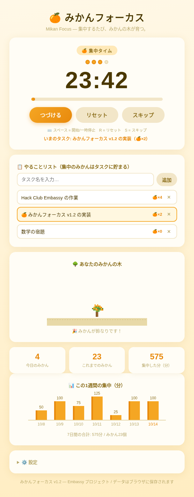

# Mikan Focus 🍊⏱️

**集中するたび、みかんの木が育つ。**
*Focus, and watch your mikan tree grow.*

A tiny pomodoro timer with a pixel-art mikan tree that grows as you complete focus sessions. Built for **Hack Club Embassy**.



## How it works

- **25分の集中タイム** → 完了すると「みかんが実る」（セッション数カウント）
- **5分の休憩タイム** → 自動で切り替え
- 集中セッションを重ねるごとに、みかんの木が成長する（種 → 芽 → 若木 → 花 → 実 → 鈴なり）
- 8セッションで木が満開になる
- 完了時は Web Audio のやさしいチャイム + 通知

## Features

- 🍅 Pomodoro timer (work/break/long-break, lengths configurable, 4-cycle long break)
- 📋 Task list — each focus session adds a 🍊 to the active task (saved locally)
- 🌳 Pixel-art mikan tree drawn on canvas — 6 growth stages
- 📊 Stats: sessions today / total / focus minutes + 7-day bar chart (canvas)
- 💾 Backup export / import (JSON) — your data stays yours
- 🔔 Chime (Web Audio, no files) + desktop notifications
- ⌨️ Keyboard shortcuts: Space = start/pause, R = reset, S = skip
- ♿ Accessibility: `role="timer"`, `aria-live` mode/stage announcements
- 📱 Responsive, works offline
- 📄 Single HTML file — no build, no dependencies

## Run it

Open `index.html` in a browser, or:

```bash
python3 -m http.server 3964
```

## Test

E2E suite (Playwright, headless Chromium) — 22 checks covering timer, tasks, chart, persistence, export/import:

```bash
uv run --with playwright python tests/e2e.py
```

## Notes

- All data stays in your browser (localStorage).
- The tree growth is cumulative — 8 sessions = fully grown.
- Task 🍊 counts start from when you create the task (sessions before v1.2 had no task).

Made for [Hack Club Embassy](https://embassy.hackclub.com/).

## Changelog

- **v1.2** — task list with per-task mikan counts, 7-day focus chart, backup export/import, a11y improvements, E2E tests
- **v1.1** — long-break cycles, keyboard shortcuts, tab title countdown, expanded settings, v1→v2 storage migration
- **v1.0** — initial release
